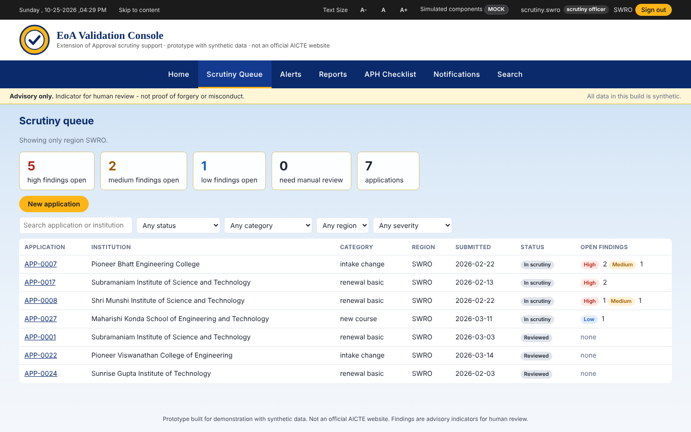
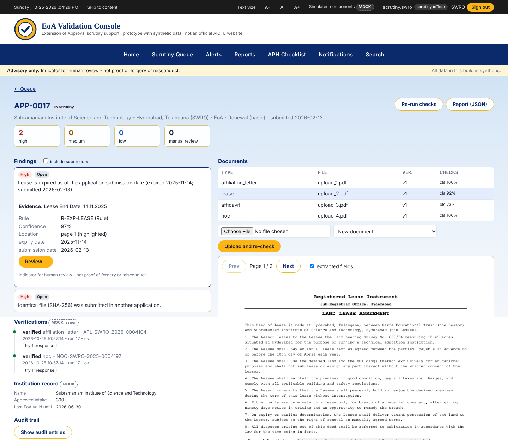
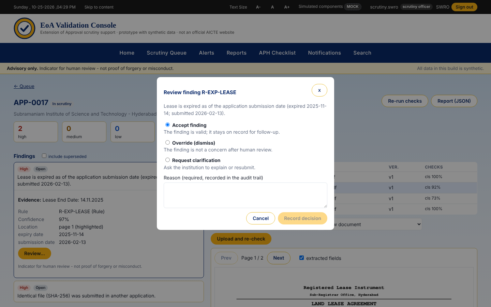
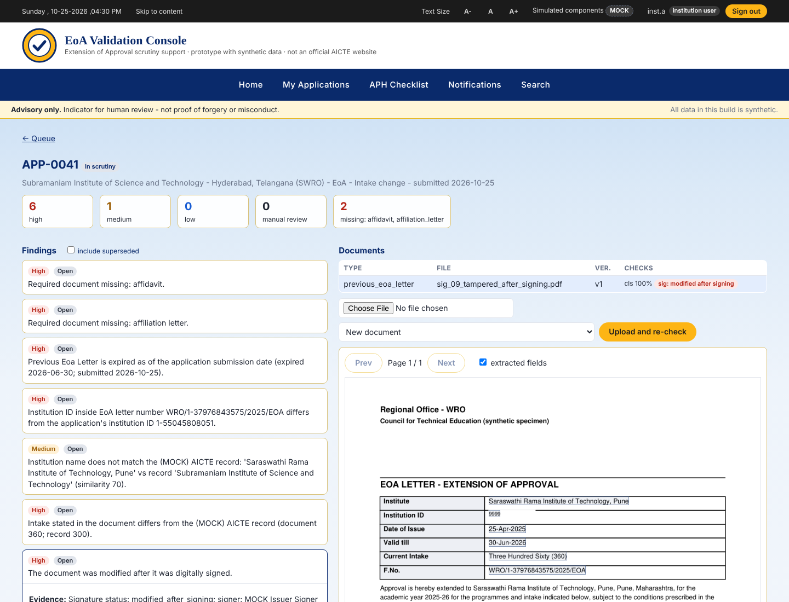
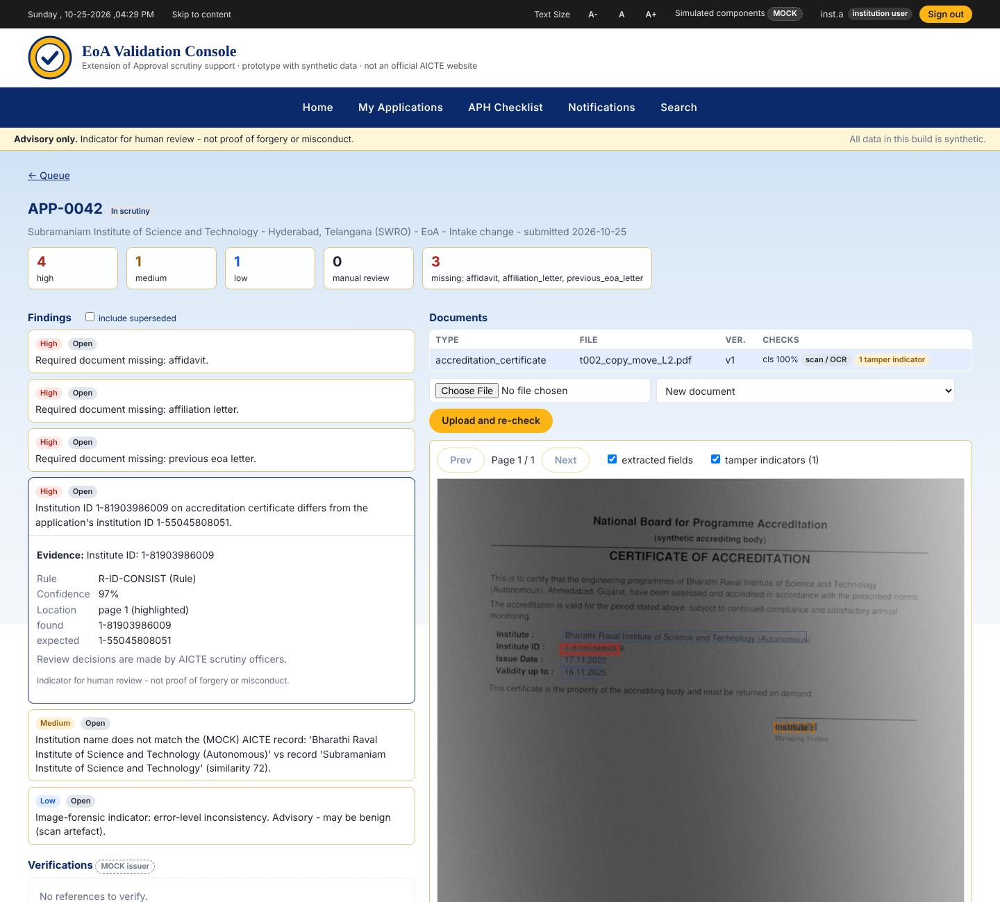
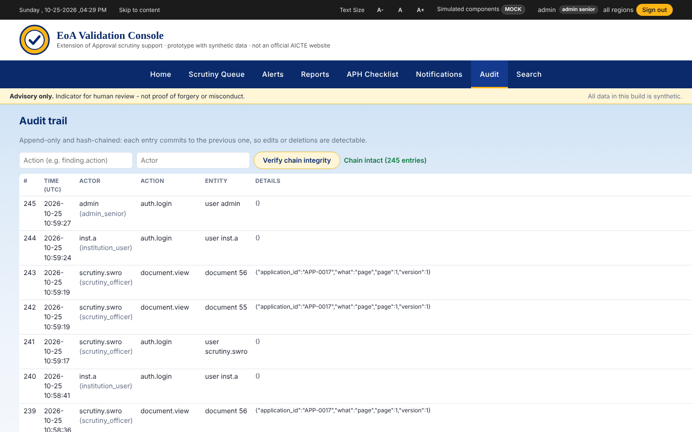
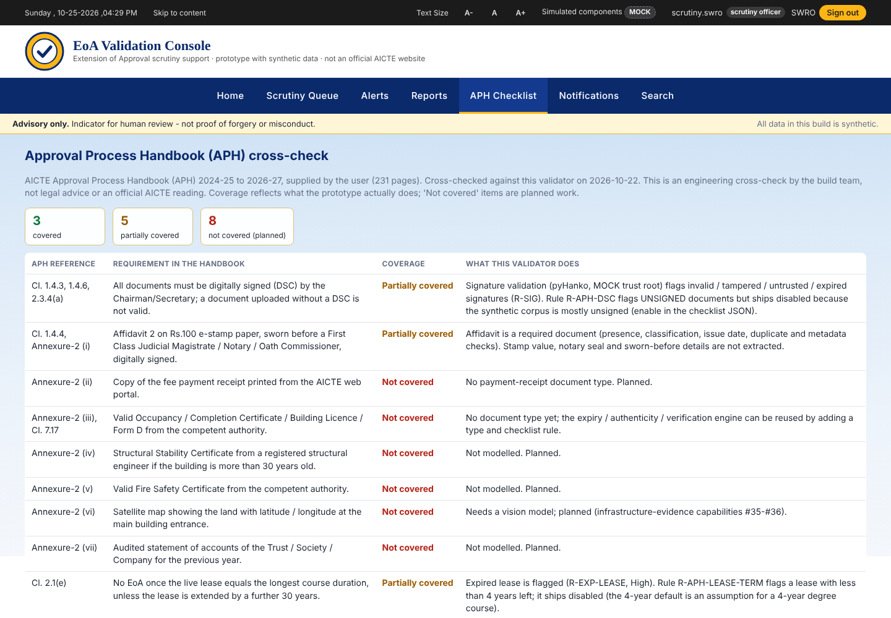
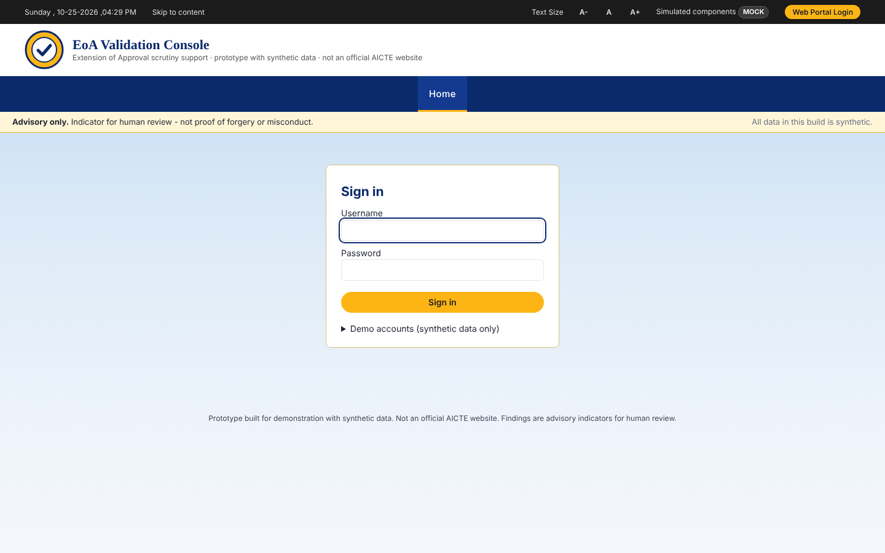
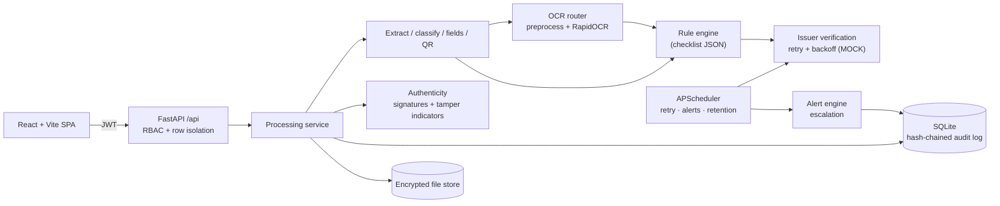

# EoA Validation Console

**AI-assisted validation, document authentication and compliance verification for AICTE Extension of Approval (EoA) applications.**
Smart India Hackathon 2026 · Problem Statement 26261 · Theme: Smart Automation · Category: Software · Team **ImpactShift**

     

> **Advisory only.** Every finding is an indicator for human review, never proof of forgery or misconduct.
> **All data is synthetic** and several external systems are **MOCK**. This is a prototype, **not an official AICTE website or system**, and it uses no official emblem.

**Live demo:** `[add deployed link]` · **Documents:** `[add Google Drive link]` · **Demo video:** `[add link]`

---

## Table of contents
1. [Problem](#problem)
2. [What it does](#what-it-does)
3. [Screenshots](#screenshots)
4. [Architecture](#architecture)
5. [Tech stack](#tech-stack)
6. [Results](#results)
7. [Quick start](#quick-start)
8. [Demo logins](#demo-logins)
9. [Demo walkthrough](#demo-walkthrough)
10. [Project structure](#project-structure)
11. [Tests and evaluation](#tests-and-evaluation)
12. [What is MOCK](#what-is-mock)
13. [Configuration](#configuration)
14. [Limitations and roadmap](#limitations-and-roadmap)
15. [Team](#team)

## Problem
Institutions submit bundles of documents to AICTE each year for Extension of Approval. Scrutiny staff check them page by page against the Approval Process Handbook (APH) 2024-27. The work is slow, varies between officers, and is hard to audit. PS 26261 asks for AI that validates the application, checks that documents are genuine, and verifies compliance with the regulations.

## What it does
- **Reads documents:** digital PDFs (PyMuPDF) and scans (preprocessing + RapidOCR); classifies the type; extracts key fields and QR codes with confidence and page position.
- **Checks compliance:** a JSON-driven rule engine compares the extracted facts with a checklist per application category (missing, expired, name/ID/intake inconsistencies, duplicates, metadata).
- **Checks authenticity:** PDF digital-signature validation (pyHanko, MOCK trust root), image-forensic tamper indicators (error-level, noise, copy-move), issuer verification with retry and backoff (MOCK).
- **Supports the officer:** ranked queue, evidence highlighted on the page, accept / override / request clarification with a mandatory reason.
- **Keeps it accountable:** hash-chained append-only audit log, role and region isolation, escalating alerts, CSV/PDF reports.
- **Is honest about the Handbook:** an APH Checklist page cross-checks 16 Handbook items (3 covered, 5 partial, 8 not covered).

## Screenshots
| | |
|---|---|
|  **Scrutiny queue**, ranked by severity |  **Evidence** highlighted on the page |
|  **Reviewer action** with required reason |  **Signature** modified after signing (MOCK trust root) |
|  **Tamper indicator**, advisory only |  **Audit chain** verification |
|  **APH Checklist** cross-check |  **Role-based sign-in** |

## Architecture

Layers: users and roles → web app → API and security → processing pipeline → rules and services → data and storage → simulated external systems. Rules, thresholds, alert timings and signature policy live in `backend/config/*.json`, not in code.

## Tech stack
| Area | Tools |
|---|---|
| Backend | Python 3.11, FastAPI, SQLAlchemy, SQLite, APScheduler |
| Document processing | PyMuPDF, RapidOCR, OpenCV/Pillow, QR decoding, pyHanko |
| Security | JWT (HS256) + bcrypt, Fernet encryption at rest, hash-chained audit log |
| Reports | reportlab (PDF), CSV |
| Frontend | React, Vite |
| Synthetic data | Python generators (seed 42), Augraphy for scan degradation |
| Testing | pytest (104 tests), Playwright for screenshots |

## Results
Measured by `python -m eval.run_eval` on a held-out **TEST** split of synthetic data (20 applications, 79 documents). These are demonstration numbers, not a validation. Full detail and caveats: [`eval/results.md`](eval/results.md).

| Area | Result |
|---|---|
| Digital PDFs: classification / field accuracy / QR | 100% / 100% (385 fields) / 100% |
| Defect detection (9 injected types) | 8 of 9 perfect; `name_mismatch` recall 0.50 (2 instances); no clean-application false positives |
| Scans, field accuracy (light / medium / heavy) | 83.0% / 60.3% / 49.6%; wrong-but-unflagged: 11 / 7 / 11 |
| Tamper indicators | recall 79.2% (19/24), precision 1.00, 0/8 clean-scan false positives |
| Signature validation | 12/12 as expected |
| Access-control matrix | 55/55 |
| Alerts (simulated clock) | max lag 4 min, 0 duplicates |
| Speed | ~2.0 s per digital application; ~4.9 s per scanned page |

## Quick start
Requires Python 3.11 and about 1 GB of disk. The React build is included in `frontend/dist`.

```bash
git clone https://github.com/<your-username>/<repo-name>.git
cd <repo-name>
python3.11 -m venv venv
source venv/bin/activate            # Windows PowerShell: venv\Scripts\Activate.ps1
pip install -r requirements.txt
python -m backend.app.seed          # about 90 s: synthetic institutions, applications, demo users
uvicorn backend.app.main:app --port 8000
```
Open http://localhost:8000 (API docs at `/docs`). `./run.sh` does the same on macOS/Linux. To rebuild the front end: `cd frontend && npm install && npm run build`.

**Deploy:** `railway.json` and `start.sh` are included for Railway (seeds once into a mounted volume, then starts uvicorn on `$PORT`). Set `AICTE_JWT_SECRET` and `AICTE_FERNET_KEY` as environment variables.

## Demo logins
All passwords are `Demo@1234` (synthetic accounts).

| Username | Role | Sees |
|---|---|---|
| `admin` | Senior administrator | all regions, audit log, users |
| `regional.swro` | Regional officer | one region; alerts and retries |
| `scrutiny.swro` | Scrutiny officer | one region; review findings |
| `inst.a` | Institution user | own institution only; upload documents |
| `inst.b` | Institution user | a different institution (isolation demo) |

Each region (CRO, ERO, NRO, SRO, SWRO, WRO) has `regional.<region>` and `scrutiny.<region>` accounts.

## Demo walkthrough
1. Sign in as `scrutiny.swro`; the queue shows only that region, ranked by severity.
2. Open `APP-0017` (expired lease); click a finding to see the evidence highlighted on the page.
3. Click *Review*, choose *Override*, enter a reason; check the audit trail.
4. Open `APP-0010` to see issuer verification retries with backoff (MOCK).
5. As `inst.a`, upload `data/synthetic/signed/sig_09_tampered_after_signing.pdf` (signature modified after signing) or `data/synthetic/tamper/t002_copy_move_L2.pdf` (tamper indicator).
6. Sign in as `inst.b` and try to open `#/applications/APP-0017`: it behaves as if it does not exist.
7. As `admin`: *Alerts → Run alert engine now*, *Reports* (CSV/PDF), *Audit → Verify chain*, *APH Checklist*.

## Project structure
```
backend/app        FastAPI app, models, auth and RBAC, routes, seed
backend/pipeline   extraction, classification, OCR, rule engine, signatures, tamper indicators
backend/services   processing, storage and crypto, audit chain, verification, alerts, reports, scheduler
backend/config     thresholds, checklists, alert rules, signature policy, APH cross-check
backend/mock       MOCK records, issuer API, scrutiny history, trust root
data/              synthetic data generators and generated corpus (seed 42)
eval/              evaluation scripts and results.md
frontend/          React + Vite source; dist/ is the served build
tests/             pytest suite
docs/              screenshots (and project documents)
```
Further reading: [`FEATURES.md`](FEATURES.md) (38-capability audit: 26 built, 4 mocked, 7 planned, 1 downgraded) and [`DECISIONS.md`](DECISIONS.md) (design choices and reasons).

## Tests and evaluation
```bash
python -m pytest -q          # 104 tests
python -m eval.run_eval      # TEST-split evaluation, writes eval/results.md (15-20 min)
python -m eval.rbac_eval     # 55-case access matrix
python -m eval.alert_eval    # alert timeliness on a simulated clock
```

## What is MOCK
| Component | Location |
|---|---|
| AICTE institution records | `backend/mock/records.json` |
| Issuer verification API (with simulated outages) | `backend/mock/issuer_api.py` |
| Scrutiny history | `backend/mock/scrutiny_history.json` |
| Signature trust root | `backend/mock/trust_root/` |
| E-mail notifications (recorded, never sent) | `services/alerts.py` |

The interface marks simulated sources with a **MOCK** badge.

## Configuration
Environment variables: `AICTE_DB`, `AICTE_VAR`, `AICTE_FERNET_KEY`, `AICTE_JWT_SECRET`, `AICTE_TOKEN_HOURS`, `AICTE_RETENTION_DAYS`, `AICTE_RETRY_MINUTES`, `AICTE_ALERT_MINUTES`, `AICTE_PURGE_MINUTES`, `AICTE_SCHEDULER=0` to disable background jobs. Development keys are generated into `var/` on first run; set real secrets for anything beyond a demo.

## Limitations and roadmap
**Limitations**
- Synthetic data from a few templates and a small test set; results do not predict real-world accuracy.
- The prototype's six document types do not match the seven in APH Annexure-2 clause 2.1 (only the affidavit overlaps).
- OCR accuracy drops on poor scans; tamper detection is heuristic with limited recall and can misfire on scan artefacts.
- Issuer verification and the signature trust root are simulated; security is demo-grade (no MFA/SSO/KMS); not load-tested.

**Roadmap**
1. Add Annexure-2 document types (fee receipt, occupancy, structural stability, fire safety, satellite map, audited accounts) and confirm the disabled rules `R-APH-DSC` and `R-APH-LEASE-TERM`.
2. Replace MOCK services with real integrations where AICTE permits.
3. Pilot on real, permitted applications with scrutiny officers.
4. Improve OCR on degraded scans; add approval-history data for the three-year eligibility rule.

## Team
**Team ImpactShift** · SIH 2026 · Team ID: `[fill in]` · College: `[fill in]` · Mentor: `[fill in]`

| Member | Role |
|---|---|
| `[Name]` | `[Role]` |

The prototype was developed with an AI assistant (Claude) under the team's direction.

## License and disclaimer
`[Choose a licence, e.g. MIT, or state "All rights reserved"]`. This project is a hackathon prototype with synthetic data. It is not affiliated with or endorsed by AICTE.
